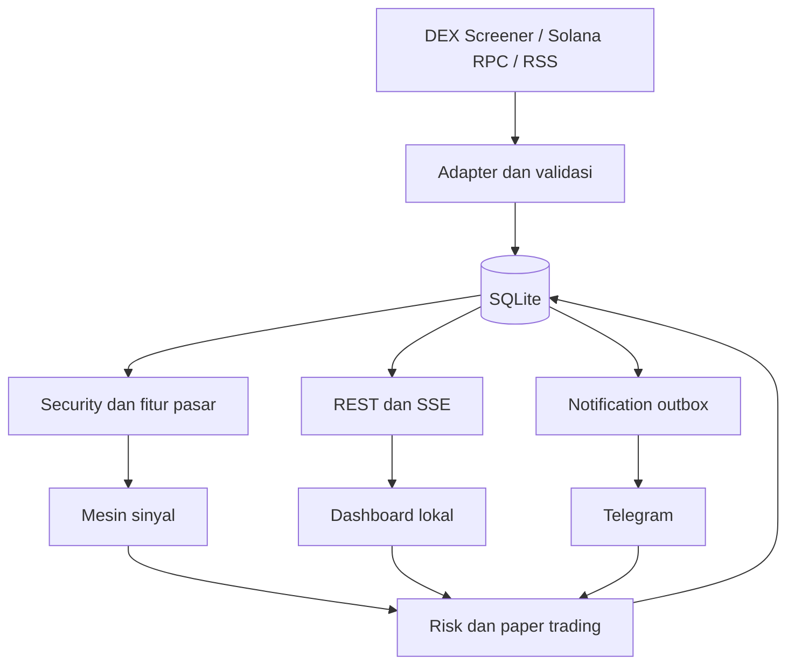

# Arsitektur dan tech stack

## Bentuk aplikasi

Satu backend Node.js melayani REST, SSE, file dashboard hasil build, scheduler, bot, dan SQLite. Modul dipisahkan dalam kode tetapi belum membutuhkan microservice, Redis, Docker, atau layanan cloud. UI tetap menerima status kesehatan jika provider eksternal sedang gagal.



## Pilihan teknologi

| Bagian | Pilihan | Alasan penggunaan |
| --- | --- | --- |
| Bahasa/runtime | TypeScript strict, Node.js 24 LTS | Bahasa bersama untuk UI, bot, dan domain |
| Paket/repository | pnpm workspace | Satu lockfile untuk aplikasi dan kontrak |
| UI | React, Vite, Tailwind CSS | Dashboard lokal dan build statis |
| Grafik | Lightweight Charts | Harga sampel, penanda posisi, kurva equity; sertakan atribusi sesuai lisensi |
| Backend | Fastify | REST, lifecycle aplikasi, dan penyajian build UI |
| Update UI | SSE + REST | Event server ke UI; aksi pengguna lewat REST |
| Database | SQLite, better-sqlite3 | Penyimpanan lokal dengan transaksi dan migrasi SQL |
| Telegram | grammY, long polling | Tidak memerlukan webhook publik |
| Solana | @solana/kit | Pembacaan RPC; tambah decoder token yang kompatibel bila diperlukan |
| Validasi | Zod | Input API, konfigurasi, dan boundary provider |
| Desimal | decimal.js; bigint untuk raw token amount | Uang/harga tidak dihitung dengan floating point biasa |
| Logging | Pino | Log terstruktur dengan redaksi rahasia |
| Tes | Vitest, Playwright | Domain/integrasi dan alur browser |

PR-001 mengunci versi stabil yang kompatibel pada lockfile dan membuktikan instalasi di Windows, termasuk native module better-sqlite3. Node 24 memakai patch yang masih didukung. Jangan mengasumsikan nomor versi library terbaru tanpa pemeriksaan saat implementasi.

## Struktur kode yang akan dibuat

```text
apps/
  server/src/
    adapters/       # market, RPC, news
    modules/        # security, signals, risk, paper, journal
    transport/      # REST, SSE, Telegram
    jobs/           # penjadwalan dan notification outbox
    db/             # migrasi dan repository
  web/src/          # dashboard
packages/
  contracts/src/    # Zod + types API, DTO, event
  domain/src/       # fungsi murni strategi, risiko, biaya
tests/fixtures/
data/               # runtime, diabaikan Git
docs/
```

## Alur dan persistensi

1. Adapter memvalidasi hasil provider dan menulis snapshot beserta sumber/waktu.
2. Fitur hanya dihitung dari data yang sudah tersedia saat itu.
3. Mesin sinyal menyimpan alasan, versi strategi, dan referensi snapshot secara atomik.
4. Risk engine mengevaluasi portofolio yang dituju, kemudian reservasi/fill dicatat dalam transaksi database.
5. Perubahan domain dan notification outbox disimpan dalam transaksi yang sama. SSE/Telegram membaca hasil yang sudah committed.
6. Callback Telegram dan REST memanggil service domain yang sama, bukan menghitung sendiri.

Gunakan satu writer process, SQLite WAL dan foreign keys. Scheduler menggunakan timer terkontrol: satu job per jenis tidak boleh overlap, timeout, retry dengan backoff, jitter, dan batas konkurensi. Timer tidak menjamin eksekusi saat Windows sleep.

## Akses dan rahasia

- Bind hanya `127.0.0.1`, default port 4317. Jika dipakai proses lain, laporkan error; jangan membunuh proses tersebut.
- Produksi lokal menyajikan UI dan API pada origin yang sama. CORS dev hanya menerima origin Vite yang dikonfigurasi; bukan wildcard.
- Validasi Host dan Origin untuk melindungi akses lokal, termasuk DNS rebinding. Mutasi harus JSON dan memakai session token lokal.
- Saat start, buat session token acak dalam memori dan URL bootstrap dengan fragment. UI mengambil token ke sessionStorage lalu menghapus fragment; token tidak masuk access log. Semua API/SSE memerlukan token; SSE memakai streaming fetch agar header autentikasi bisa dikirim.
- Bot token ada di `.env` yang diabaikan Git, tidak pernah dikirim ke browser. `.env.example` hanya placeholder.
- Telegram hanya menerima chat ID dan user ID yang diizinkan; semua callback dicek ulang. Tidak ada endpoint yang mengirim transaksi on-chain.
- RSS dan link eksternal diperlakukan sebagai input tidak tepercaya: escape teks, larang HTML/script mentah, URL http(s) saja; server hanya mengambil feed dari allowlist.

## Operasional lokal

Database dan log disimpan di `data/`. Startup menjalankan migrasi, memuat konfigurasi, memeriksa job terakhir, merekonsiliasi posisi, lalu memulai scheduler. Tanpa Telegram token, dashboard tetap dapat beroperasi dengan status Telegram nonaktif.

Shutdown menghentikan entry baru, menyelesaikan transaksi DB, menghentikan polling, dan menutup koneksi. Backup memakai mekanisme backup SQLite yang konsisten; jangan hanya menyalin berkas database aktif tanpa WAL.

## Referensi resmi

- [Node.js release schedule](https://github.com/nodejs/Release)
- [Vite](https://vite.dev/guide/)
- [Fastify TypeScript](https://fastify.dev/docs/latest/Reference/TypeScript/)
- [Solana SDK](https://solana.com/docs/frontend)
- [Telegram long polling](https://core.telegram.org/bots/faq)
- [Lightweight Charts dan atribusi](https://github.com/tradingview/lightweight-charts)
