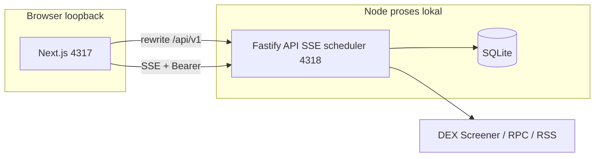

# Migrasi dashboard ke Next.js

Tanggal: 2026-11-08. Dokumen ini menjelaskan **mengapa**, **target arsitektur**, **pemetaan kode**, dan **risiko** saat mengganti lapisan UI dari React/Vite ke **Next.js App Router**, tanpa mengubah filosofi produk (lokal, loopback, simulasi, tanpa wallet).

## Latar belakang

| Hari ini | Setelah migrasi (target) |
| --- | --- |
| `apps/web`: SPA React + Vite + Tailwind | `apps/web`: Next.js App Router + Tailwind |
| Produksi: Fastify menyajikan `dist` Vite + `/api/v1` pada **4317** | Produksi: Next sebagai **gerbang HTTP** pada **4317**; Fastify tetap menjalankan API/SSE/scheduler (port internal, mis. **4318**) |
| Dev: Vite terpisah + `VITE_API_ORIGIN` | Dev: `next dev` + rewrite/proxy ke Fastify |
| Routing: state `page` di `main.tsx` | Routing: segment App Router (`/ringkasan`, `/watchlist`, …) |
| Grafik: lazy `import()` + client-only | Grafik: komponen `'use client'` (Lightweight Charts) |
| Sesi: fragment URL → `sessionStorage` | Sesi: tetap loopback; bootstrap lewat halaman Next atau fragment yang sama (lihat PR-015) |

**Tidak berubah pada migrasi UI:** `apps/server`, `packages/contracts`, `packages/domain`, SQLite, scheduler, adapter, kontrak REST/SSE, Telegram, dan aturan keamanan domain.

## Tujuan migrasi

1. **Routing dan struktur halaman** — URL dapat dibagikan/deep-link per workspace (watchlist, penemuan, jurnal) tanpa mempertahankan satu state monolit.
2. **Pemisahan server/client eksplisit** — boundary `'use client'` untuk polling, SSE, chart, dan dialog; layout stabil di server.
3. **Jalur pengembangan modern** — ekosistem Next (metadata, loading UI, error boundary) tetap **tanpa** mengubah backend menjadi serverless atau hosting publik.
4. **Pemeliharaan jangka panjang** — mengurangi custom glue Vite+FASTIFY static; launcher tetap satu perintah untuk pengguna Windows.

## Non-tujuan (eksplisit)

- Hosting internet, Vercel produksi, atau akses remote.
- Menggabungkan scheduler/Telegram ke dalam Route Handler Next (tetap proses Node `apps/server`).
- Trading nyata, wallet, atau RSC yang memanggil RPC/Solana langsung dari edge.
- Menghapus Fastify sebelum fase cutover (PR-016) dan smoke lulus.

## Arsitektur target



### Pola yang direkomendasikan: **dual-process loopback**

1. **Fastify** (`apps/server`): semua `/api/v1/*`, `/api/v1/events` (SSE), migrasi DB, `Services.start()`, Telegram.
2. **Next** (`apps/web`): HTML/JS/CSS, bootstrap sesi, proxy API dengan header `Authorization` yang sama seperti hari ini.
3. **Launcher** (`start.ps1` / `scripts/dev.ts`): jalankan keduanya; health check menunggu backend lalu membuka `http://127.0.0.1:4317`.

Alternatif yang **tidak** direkomendasikan untuk MVP migrasi:

- **Custom server Next-only** yang memuat Fastify dalam satu proses — sulit di-debug sleep/recovery dan menimpa model single-writer SQLite.
- **Route Handler menggantikan seluruh REST** — duplikasi kontrak dan risiko drift dengan `packages/contracts`.

## Pemetaan kode (Vite → Next)

| Asal (`apps/web/src`) | Tujuan (Next App Router) |
| --- | --- |
| `main.tsx` (nav + switch `page`) | `app/(app)/layout.tsx` + `app/(app)/*/page.tsx` |
| `api.ts` | `lib/api.ts` (base URL relatif `/api/v1` atau env `NEXT_PUBLIC_API_ORIGIN`) |
| `session.ts` | `lib/session.ts` + `app/bootstrap/page.tsx` atau parsing fragment di `app/page.tsx` |
| `dto.ts` | `lib/dto.ts` (schema Zod sama) |
| `Chart.tsx` | `components/charts/*.tsx` dengan `'use client'` |
| `Journal.tsx` | `app/(app)/jurnal/page.tsx` + client child |
| `styles.css` | `app/globals.css` (Tailwind v4 tetap) |
| `index.html` | dihapus; metadata di `app/layout.tsx` |

Backend:

| File | Perubahan |
| --- | --- |
| `apps/server/src/app.ts` | `serveUi: false` permanen setelah cutover; CSP/CORS izinkan origin Next di dev |
| `fastify-static` | Dihapus dari jalur produksi setelah PR-016 |
| `scripts/dev.ts` | Ganti Vite → `next dev`; tetap spawn Fastify |
| `start.ps1` / build | `pnpm --filter @memecoin/web build` + `next start` atau `node .next/standalone` |

## Konfigurasi Next (ringkas)

Contoh `next.config.ts` (nilai port disesuaikan env):

```typescript
import type { NextConfig } from 'next';

const apiOrigin = process.env.API_INTERNAL_ORIGIN ?? 'http://127.0.0.1:4318';

const nextConfig: NextConfig = {
  output: 'standalone',
  reactStrictMode: true,
  async rewrites() {
    return [{ source: '/api/v1/:path*', destination: `${apiOrigin}/api/v1/:path*` }];
  },
};

export default nextConfig;
```

**Catatan keamanan:** rewrite hanya ke loopback; jangan arahkan ke host eksternal. Validasi Host/Origin di Fastify harus mencantumkan origin Next (`http://127.0.0.1:4317`).

## Sesi dan autentikasi

Perilaku yang harus **identik** sebelum/ sesudah migrasi:

1. Token sesi acak dibuat saat start backend (atau orchestrator).
2. URL bootstrap membawa token di **fragment** (bukan query) agar tidak masuk log.
3. Browser menyimpan token di `sessionStorage`; header `Authorization: Bearer …` pada REST dan SSE.
4. 401 menghapus sesi dan meminta restart peluncur.

Opsi implementasi Next:

- **A (minimal):** halaman statis `public/bootstrap.html` atau route client yang membaca `location.hash` — sama seperti SPA.
- **B (lebih rapi):** Route Handler `GET /session` hanya di development yang membaca token dari env orchestrator — **jangan** mengekspos token ke SSR HTML di produksi tanpa fragment.

PR-015 memutuskan A vs B dan memperbarui [api-contracts.md](api-contracts.md) jika ada endpoint baru.

## SSE dan “realtime” UI

- Tetap `fetch` streaming ke `/api/v1/events` (lewat rewrite).
- Komponen client (`useEffect`) memanggil `stream()` dari `lib/api.ts`; tidak gunakan EventSource bawaan browser jika header Bearer wajib.
- Reconnect/backoff mengikuti perilaku `apps/web/src/api.ts` saat ini.

## Grafik (Lightweight Charts)

- Paket `lightweight-charts` hanya di client; impor dinamis atau file terpisah dengan `'use client'`.
- Pertahankan atribusi TradingView di `figcaption`.
- Hindari SSR untuk chart (tidak ada `window`).

## Pengujian

| Jenis | Perubahan |
| --- | --- |
| Vitest domain/server | Tanpa perubahan besar |
| Playwright | `baseURL` → `http://127.0.0.1:4317`; navigasi pakai URL path, bukan klik nav semata |
| Smoke | Perbarui untuk dua port atau satu port + rewrite |
| Kontrak API | Tidak berubah kecuali dokumentasi origin/CORS |

## Fase implementasi (task PR)

| Fase | Task | Deliverable |
| --- | --- | --- |
| 1 | [PR-013](tasks/PR-013-nextjs-scaffold.md) | Workspace Next, Tailwind, build, env, tanpa fitur |
| 2 | [PR-014](tasks/PR-014-nextjs-pages.md) | Port halaman + navigasi + empty/error states |
| 3 | [PR-015](tasks/PR-015-nextjs-api-sse-session.md) | Proxy, sesi, SSE, idempotency |
| 4 | [PR-016](tasks/PR-016-nextjs-cutover.md) | Launcher, hapus Vite, E2E, dokumentasi operasi |

Urutan **wajib** 013 → 014 → 015 → 016. PR-014 boleh memakai mock data sementara proxy belum siap; cutover hanya setelah 015 lulus.

## Risiko dan mitigasi

| Risiko | Mitigasi |
| --- | --- |
| Drift kontrak API | Semua parse tetap `successEnvelopeSchema`; jangan duplikasi Zod di server Next |
| CSP memblokir Next dev | Mode dev longgarkan `script-src`; produksi tetap ketat |
| Dua port membingungkan pengguna | Launcher satu perintah; dokumentasi hanya menyebut **4317** |
| SSE putus lewat proxy | Uji buffer/chunked; hindari middleware yang mem-buffer body |
| `better-sqlite3` di bundle Next | **Jangan** impor server ke client; DB hanya di `apps/server` |
| Waktu build lebih lama | CI tetap `build:packages` lalu `web build` |

## Rollback

Sebelum PR-016 selesai, pertahankan branch/tag dengan Vite. Cutover: tag `pre-nextjs`; jika gagal, kembalikan `serveUi: true` dan build Vite di Fastify sambil mematikan proses Next.

## Dokumen terkait yang perlu disinkronkan saat cutover

- [architecture.md](architecture.md) — baris UI dan diagram alur HTTP
- [operations.md](operations.md) — port, dev, troubleshooting
- [testing.md](testing.md) — Playwright dan smoke
- [README.md](../README.md) — perintah `pnpm dev` / `start.cmd`
- [api-contracts.md](api-contracts.md) — origin dan bootstrap sesi

## Kriteria migrasi selesai

1. `pnpm test`, `pnpm test:e2e`, dan `pnpm test:smoke` lulus dengan Next sebagai UI.
2. Tidak ada dependensi Vite pada jalur produksi.
3. Pengguna Windows masih menjalankan satu launcher dan membuka **4317**.
4. Perilaku simulasi, discovery, buy/sell chart, dan Telegram tidak berubah secara fungsional (selain URL halaman).
