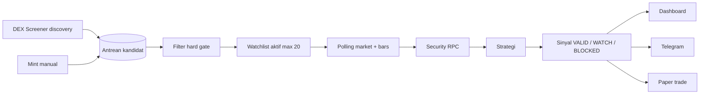

# Redesign V2 — discovery hybrid, sinyal, eksekusi terpisah

Tanggal: 2026-11-06. Keputusan dari diskusi produk: **full redesign bertahap**, model **hybrid** (discovery otomatis + watchlist manual), dan **desain** mencakup trade nyata di fase akhir — **bukan** implementasi wallet/signing dalam fase awal.

Dokumen ini menggantikan asumsi “hanya watchlist manual” sebagai satu-satunya cara menemukan kandidat, tanpa mengubah batas keamanan dan kejujuran data yang sudah ada di MVP.

## Tujuan produk (V2)

Pengguna ingin alur:

1. **Menemukan** kandidat dari pasar Solana DEX (terbatas API gratis), bukan hanya mint yang diketik manual.
2. **Memfilter** dengan aturan terbuka (likuiditas, usia pool, keamanan, warm-up, strategi).
3. **Menerima sinyal** di dashboard dan Telegram (simulasi, dengan alasan dan expiry).
4. **Trade nyata** dilakukan pengguna sendiri di fase awal; modul eksekusi on-chain hanya **placeholder arsitektur** sampai spesifikasi risiko dan izin eksplisit terpisah.

Yang **tidak** dijanjikan V2:

- Scan seluruh chain tanpa batas atau “semua token Solana”.
- Ranking profit, probabilitas menang, atau label “koin bagus / pasti untung”.
- Jaminan token aman; security PASS tetap pemeriksaan terbatas.
- Pengawasan 24 jam saat PC mati.

## Perbedaan dengan MVP (PR-001–012)

| Aspek | MVP saat ini | V2 target |
| --- | --- | --- |
| Sumber kandidat | Watchlist manual (maks. 20) | Discovery DEX Screener + promosi ke watchlist (tetap maks. 20 **aktif dipantau**) |
| UI | Watchlist, sinyal, posisi | Tambah halaman **Penemuan** (antrean kandidat, skor aturan, alasan tolak) |
| Sinyal live | Terhalang GAP-01 (`SECURITY_UNKNOWN`) | GAP-01 wajib sebelum klaim sinyal dari data nyata |
| Telegram | Perintah + outbox | Sinyal baru + invalidasi (setelah GAP-02/03) |
| Trade nyata | Di luar scope | Fase 4+: antarmuka `ExecutionPort` (desain), implementasi terpisah |

## Model hybrid discovery



### Sumber discovery (gratis, terbatas)

Acuan API DEX Screener (bukan scan on-chain penuh):

- **Profil / boosted / search** endpoint yang didokumentasikan (refresh terjadwal, anggaran request internal).
- Normalisasi ke mint + pool kanonik (DEX yang didukung: Raydium, Orca, Meteora, PumpSwap — sama seperti adapter sekarang).
- Dedupe mint; simpan `firstSeenAt` observasi lokal, bukan waktu publikasi marketing.

Batas operasional (disarankan, bisa dikonfigurasi):

- Discovery job: setiap 10 menit, backoff jika 429.
- Antrean kandidat: simpan hingga N mint (mis. 200) dengan TTL; hanya yang **dipromosikan** masuk watchlist aktif.
- Watchlist aktif: **maks. 20** (tetap).

### “Skor” kandidat

Bukan skor profit. **Skor aturan** (contoh bobot dokumentasi):

- Likuiditas USD vs ambang minimum.
- Volume 24 jam vs ambang.
- Usia pool vs minimum jam.
- Status keamanan (PASS > UNKNOWN > FAIL).
- Kelengkapan bar (progress warm-up 0–60).

Tampilkan sebagai **urutan penjelasan**, bukan “beli sekarang”. Tombol UI: **Pantau** (promosi ke watchlist), bukan **Beli**.

## Fase implementasi

### Fase 0 — Dokumen dan kontrak (selesai sebagian dengan file ini)

- Selaraskan `product-requirements.md`, `architecture.md`, `api-contracts.md`, `data-model.md` saat fase berikutnya dimulai.
- Tambah task PR-013+ di `docs/tasks/` per fase.

### Fase 1 — Discovery + antrean + UI Penemuan

**Deliverable:**

- Tabel `discovery_candidates` (mint, pool saran, skor aturan, reason codes, firstSeenAt, expiresAt).
- `DiscoveryService` + perluasan `DexAdapter` (search/profiles sesuai API resmi).
- REST: `GET /api/v1/discovery`, `POST /api/v1/discovery/:mint/promote`, `POST /api/v1/discovery/:mint/dismiss`.
- UI: halaman **Penemuan**, kartu dengan alasan dan tombol Pantau / Abaikan.
- Job scheduler: discovery tidak overlap dengan `market.collect` saat anggaran habis.

**Kriteria selesai:** fixture + integrasi mock DEX; antrean terisi tanpa watchlist manual; promosi menghormati batas 20.

### Fase 2 — GAP-01 keamanan produksi

**Deliverable:** decoder + klasifikasi POOL/BURN/HOLDER terverifikasi untuk protokol yang didukung; adapter produksi dapat PASS atau FAIL beralasan; tes rekaman RPC offline.

**Kriteria selesai:** token fixture negatif/positif; entry tidak lagi selalu `SECURITY_UNKNOWN` untuk pool yang didukung.

### Fase 3 — Sinyal andal + Telegram

**Deliverable:** GAP-02 (revalidasi outbox), GAP-03 (backoff antrean chat), GAP-04 (konsistensi jurnal); event `signal.created` ke Telegram dengan dedupe; pesan invalidasi.

**Kriteria selesai:** E2E mock + satu uji manual Telegram sesuai instruksi pengguna.

### Fase 4 — Desain eksekusi (tanpa implementasi default)

**Deliverable desain saja:**

```text
packages/domain/src/execution.ts   # interface murni (quote, submit, status) — stub
apps/server/src/modules/execution.ts  # NO-OP / disabled default
```

- Mode default: `EXECUTION_MODE=disabled`.
- Fase implementasi nyata memerlukan dokumen terpisah: wallet custody, batas kerugian harian on-chain, slippage max, konfirmasi manusia, audit log — **di luar** fase 1–3.

Asisten implementasi **tidak** mengaktifkan signing atau swap otomatis tanpa spesifikasi dan izin eksplisit pada task terpisah.

## Arsitektur modul (perubahan direncanakan)

```text
apps/server/src/
  adapters/dex.ts          # + discoverSearch(), discoverProfiles()
  modules/discovery.ts     # baru
  modules/market.ts        # collect hanya watchlist + pinned
  modules/security.ts      # fase 2
  modules/signals.ts       # unchanged contract, input dari watchlist
  modules/execution.ts     # fase 4 stub
apps/web/src/
  Discovery.tsx            # halaman Penemuan
  main.tsx                 # nav + routing
packages/contracts/src/
  discovery.ts             # DTO antrean kandidat
```

Alur data tetap: **satu writer SQLite**, outbox Telegram, session lokal 127.0.0.1.

## Copy produk (dashboard & Telegram)

Wajib tampil di Penemuan dan sinyal:

- “Urutan aturan, bukan rekomendasi profit.”
- “Security PASS = pemeriksaan terbatas, bukan audit.”
- “Trade on-chain dilakukan di luar aplikasi kecuali modul eksekusi diaktifkan secara eksplisit (fase lanjutan).”

Telegram: tetap prefix **SIMULASI**; sinyal VALID = peluang entry **simulasi**, bukan order.

## Urutan kerja yang disarankan

1. Fase 1 (discovery) — langsung terasa “memindai pasar” dalam batas DEX Screener.
2. Fase 2 (GAP-01) — sinyal dari kandidat yang dipantau bisa lahir.
3. Fase 3 — Telegram dan jurnal konsisten.
4. Fase 4 — hanya desain/stub eksekusi; keputusan trade nyata tetap manual sampai task eksekusi disetujui.

## Sinkronisasi dokumen lama

Saat fase dimulai, perbarui:

- `product-requirements.md` — bagian kandidat/discovery.
- `roadmap.md` — PR-013 s/d PR-016.
- `remaining-work.md` — GAP-01 tetap P0 sebelum evaluasi strategi nyata.

MVP PR-001–012 tetap dasar kode; V2 menambah modul, bukan rewrite total.
